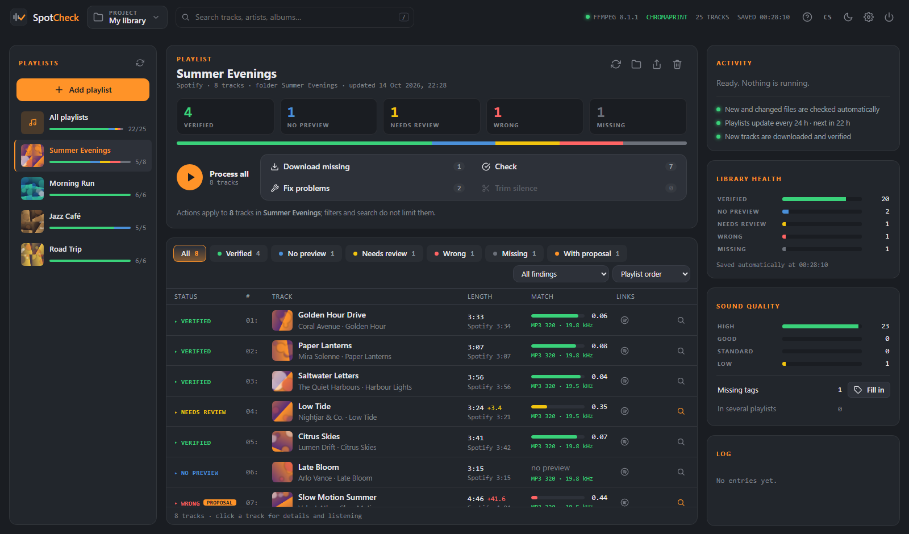
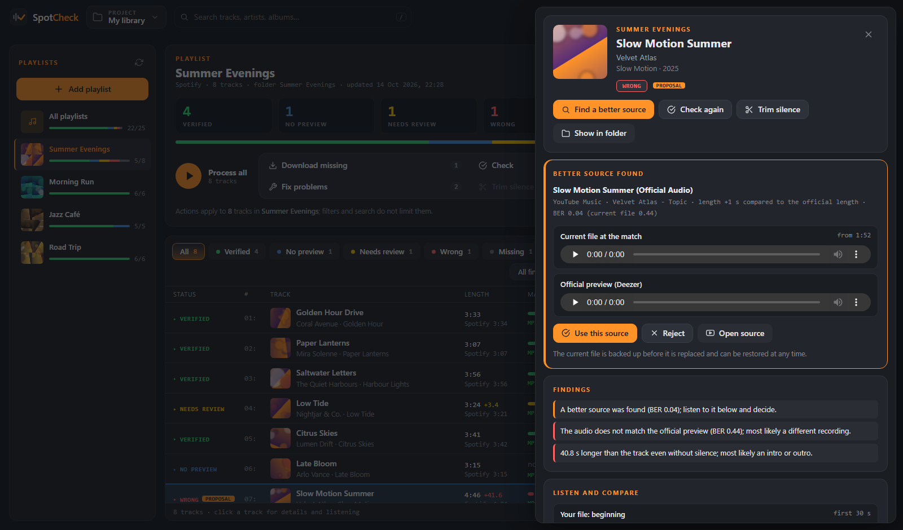
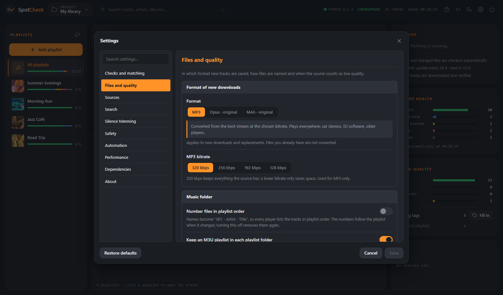

# SpotCheck

[](https://github.com/djkvido/spotcheck/actions/workflows/ci.yml)
[](LICENSE)
[](https://github.com/djkvido/spotcheck/releases/latest)

SpotCheck is a small open-source project that keeps a local music library in order. You give it playlists from Spotify, YouTube, YouTube Music, SoundCloud or Bandcamp; it finds their tracks on publicly available sources, keeps them in one folder per playlist and checks that every file really is the song it claims to be and sounds as good as it should. Each file is compared with the official 30-second preview by audio fingerprint, and its length, silence, integrity and real sound quality are measured. It runs on your computer and you control it from your browser.

**[Download for Windows and macOS](https://github.com/djkvido/spotcheck/releases/latest)** · [Run from source](#running-from-source) · [How it works](#how-verification-works)



https://github.com/user-attachments/assets/c3a837d0-3a1c-400e-b947-7363cf7d1730

*An 80-second overview with a sample library. Music by Kvido Production.*

> SpotCheck started as a hobby project and is shared as it is, for people who like their music files tidy. Please use it responsibly: for your own listening and only for music you are allowed to keep, never to share or sell anything. It does not download from Spotify, does not bypass any copy protection and does not host any music. Using it means agreeing to the [Terms of Use](TERMS.md) ([česky](TERMS.cs.md)).

## Why SpotCheck

Tools that build a local copy of a playlist, such as [spotDL](https://github.com/spotDL/spotify-downloader), do not take audio from the streaming service itself. They search public sources for each track and pick the closest result. Usually that is the right recording, but automatic matching has known weak points:

- a different recording under the same name: a live version, a cover, a remix, another master or a long mix;
- titles with annotations such as a version, tempo or dance style, which searches often do not find;
- silence or an intro at the start or end, which makes the file longer than the original;
- uploads of low sound quality, or files whose bitrate was inflated from a worse source.

Checking a whole library by ear takes hours. SpotCheck checks every file against the official preview and metadata automatically and leaves you only the tracks that really need a listen.

## Features

- **Playlists from several services:** Spotify playlists and albums (through spotDL), YouTube and YouTube Music playlists, SoundCloud sets and Bandcamp albums (through yt-dlp). Tracks of the latter are matched with the official release on Deezer, so their length and preview are verified like Spotify tracks.
- **Downloads** into one folder per playlist, with tags and cover art. Choose **Opus** or **M4A** to keep YouTube's own stream without re-encoding, or **MP3** at a bitrate of your choice.
- **Real sound quality:** SpotCheck measures where each file's spectrum ends, which is where the encoder cut off the high frequencies, and flags low-quality sources and files whose bitrate was inflated from a worse source. Among candidates of the same recording, the better sounding one wins.
- **Verification against the official preview** from Deezer, with iTunes as a fallback. The preview is located inside your file by its [Chromaprint](https://acoustid.org/chromaprint) fingerprint, so you know whether it really is the same recording.
- **File checks:** length compared with the official length (which gives away intros and outros), silence at the start and end, damaged or truncated audio and low bitrate.
- **Better sources** from YouTube Music, YouTube and SoundCloud. Every candidate is verified by fingerprint before it is offered to you.
- **Nothing is overwritten without your consent.** A better source is only proposed; you listen to it next to your current file and decide. Every replacement and trim keeps a backup that you can restore with one click.
- **Lossless silence trimming** without re-encoding; tags and cover art are kept in MP3, M4A and Opus.
- **Tidy music folder:** optional numbering of file names in playlist order (`001 - Artist - Title`), an M3U playlist in every playlist folder, missing tags and covers filled in, and a track that is verified in one playlist is copied into another instead of being downloaded again.
- **Export** of playlists with their tracks and M3U files into another folder, for example onto a USB stick, optionally numbered.
- **Runs by itself.** New or changed files in the music folder are checked automatically, playlists are updated from their sources on a schedule and new tracks arrive downloaded and verified. Automatic jobs never replace or trim files you already have.
- **Projects:** separate libraries with their own music folder, playlists, settings and history. A project can be saved to a small file and opened elsewhere.
- **Playlist overview and filters:** cover previews and health per playlist, filters by status and by finding (silence, intro, different length…), search across titles, artists, albums and files.
- **Every action explains itself:** buttons show how many tracks they would touch, ask before changing files and report what happened. Settings are validated as you type.
- **Tuning** of every threshold, search template and source, with defaults that work for most libraries.
- **CSV export** of the current view.
- **English and Czech UI**, picked from your browser language and switchable in the top bar.



## Download

Get the installer for your system from the [latest release](https://github.com/djkvido/spotcheck/releases/latest):

| System | File |
|---|---|
| Windows 10 and 11 (64-bit) | `SpotCheck-<version>-windows-x64-setup.exe` |
| macOS 11 or newer on Apple Silicon | `SpotCheck-<version>-macos-arm64.dmg` |

Everything SpotCheck needs is included (Python, FFmpeg with Chromaprint, Deno), so nothing else has to be installed. On Windows, SpotCheck installs for your user account without administrator rights; on macOS, drag it into Applications. Your music goes to `Music/SpotCheck`, the app's own data to `%LOCALAPPDATA%\SpotCheck` or `~/Library/Application Support/SpotCheck`.

The installers are not yet signed with a code-signing certificate. On Windows, SmartScreen may show *Windows protected your PC*: choose **More info › Run anyway**. On macOS, the first start is blocked: open **System Settings › Privacy & Security** and choose **Open Anyway** next to SpotCheck.

Every release lists the SHA-256 hash of each file and carries a signed [build provenance attestation](SECURITY.md#how-the-releases-are-built) proving that it was built by GitHub Actions from this repository.

SpotCheck opens in your browser at `http://127.0.0.1:8765/` and only accepts connections from your own computer. Starting it again while it runs only brings it up; the power button in the top bar stops it. The installer and the first start ask you to agree to the [Terms of Use](TERMS.md).

## Running from source

Download the repository (`git clone https://github.com/djkvido/spotcheck.git`, or *Code › Download ZIP* on GitHub) and run the installer:

**Windows:** double-click `install.bat`. It installs Python 3.12 through winget when no Python 3.10 or newer is found, creates a virtual environment, installs spotDL, yt-dlp and the other dependencies, installs FFmpeg with chromaprint and Deno, adds a SpotCheck shortcut to the desktop and starts the app. From then on use the shortcut or `start.bat`.

**Linux and macOS:** run `./install.sh`. It sets up the same environment and starts the app; Python and FFmpeg come from your package manager (`sudo apt install python3-venv ffmpeg` or `brew install python ffmpeg`); see [FFmpeg](#ffmpeg) for the chromaprint support that verification needs. Later use `./start.sh`.

The start scripts take care of the rest: the very first start installs everything, and after an update (`git pull`) they install new dependencies before starting. Starting SpotCheck while it is already running only opens it in the browser, and when the port is taken by another program the next free one is used. The app opens at `http://127.0.0.1:8765/` and only accepts connections from your own computer.

If you prefer to manage the environment yourself, `pip install -e .` followed by `spotcheck --setup` does the same thing.

### FFmpeg

Verification needs an FFmpeg build with chromaprint support. The "full" Windows builds from [gyan.dev](https://www.gyan.dev/ffmpeg/builds/) and the Debian and Ubuntu packages include it; other builds may not. Check with:

```bash
ffmpeg -hide_banner -muxers | grep chromaprint
```

To use a specific FFmpeg binary, point the `SPOTCHECK_FFMPEG` environment variable at it. The **Dependencies** panel in the app shows what was found and offers updates.

### Projects and where your files go

Each project has a music folder of your choice, with one subfolder per playlist. Tracks that are already in the folder are recognised and not downloaded again. Switch, create, rename or save projects with the project button in the top bar.

When you run SpotCheck from source, the first project uses `downloads/` for music and `data/` for its library and backups in the application home. The home also holds `projects.json`, the data of further projects (`projects/`) and caches shared by all projects (`cache/`). It defaults to the directory you start the app from; use `--home` or the `SPOTCHECK_HOME` environment variable to choose another one:

```bash
spotcheck --home ~/Music/spotcheck
```

Run `spotcheck --help` for the other options (`--host`, `--port`, `--no-browser`).

## Usage

1. **Add a playlist.** Paste links to playlists or albums from Spotify, YouTube, YouTube Music, SoundCloud or Bandcamp; each link is checked before anything is loaded. By default the tracks are then downloaded, checked and verified straight away.
2. **Look at what is flagged.** Filter by *Needs review* or *Wrong*, or by a finding such as silence at the end, and click a track to open its details: your file at the matching position next to the official preview, the match curve, lengths, backups and links.
3. **Review proposals.** When a better source is found, the track gets a *proposal* badge. Listen to it, then use it or reject it.
4. **Let it run.** Playlists are updated from their sources every 24 hours and changed files are re-checked; the Activity card shows what is planned next. *Process all*, *Fix problems* and *Trim silence* are there when you want to act on the whole selection yourself.
5. **Tune if needed.** Settings cover the download format, numbering and playlist files, the quality and match thresholds, where to search, search templates, penalised words, trimming, backups, automation and how many tracks are processed in parallel. The **?** button in the top bar explains every button and status.



| Status | Meaning |
|---|---|
| Verified | The audio matches the official preview. |
| No preview | No preview exists; at least the length matches. |
| Needs review | Only a partial match, or the file is suspiciously long. Worth a listen. |
| Wrong | A different recording, a damaged file or a clearly different length. |
| Missing / Not checked | The file has not been downloaded or checked yet. |

## How verification works

Chromaprint computes a fingerprint of the preview and of the whole file. The preview is slid along the file's fingerprint, and at each position SpotCheck measures the share of differing bits (the bit error rate, BER): 0 means identical audio, around 0.5 means unrelated audio. Fingerprints depend on exactly where the analysed frames start, so the comparison is repeated with the file shifted by fractions of a frame and the best result is kept. Without that, the BER of the very same recording varies between 0.03 and 0.13.

In practice, correct recordings score between 0.01 and 0.30 and unrelated tracks 0.42 or more. The range in between usually means a different mix, master or live version, which is why those tracks are marked for review rather than rejected.

## How quality is measured

The bitrate in a file's header says little about how it sounds: an MP3 converted to 320 kbps from a 128 kbps source still sounds like 128 kbps. Lossy encoders remove the highest frequencies, and the lower the bitrate, the lower the cut: about 16 kHz for 128 kbps MP3 or AAC, 19 to 20 kHz for 320 kbps MP3 and YouTube's Opus. SpotCheck measures the level above each frequency from 11 to 21 kHz in the body of the track and finds where it drops by 12 dB or more within one kilohertz. Music that is merely quiet at the top falls off gently and is not mistaken for a cut.

A file converted from a low-quality source therefore shows a cut well below what its bitrate suggests, and such files are the ones worth replacing.

## Troubleshooting

| Problem | What to do |
|---|---|
| Downloads fail with HTTP 403 | Update yt-dlp in Settings › Dependencies. YouTube changes often. |
| A player cannot open Opus files | Choose MP3 (320 kbps) or M4A in Settings › Files and quality. Files you already have stay as they are. |
| Some tracks of a YouTube or SoundCloud playlist are missing | Private, deleted and preview-only tracks are skipped; the log lists how many. |
| Tracks are never verified | Your FFmpeg build lacks chromaprint (see above). |
| Tracks with annotated titles are not found | Adjust the search templates in Settings. `{title}` is the title without annotations such as a version, tempo or dance style. |
| iTunes previews are slow | Apple rate-limits its search API. Keep only Deezer enabled in Settings. |
| The page looks outdated after an update | Reload it with Ctrl+F5. |

## Privacy

SpotCheck has no account, no analytics and no telemetry. Everything stays on your computer. It only contacts the services it needs for your playlists: Spotify, YouTube, YouTube Music, SoundCloud or Bandcamp for track lists and audio, Deezer and the iTunes Search API for official previews and metadata, the lyrics sites spotDL uses (Genius, AZLyrics, Musixmatch), and PyPI when the Dependencies page checks for updates. Updates and installations of components start only after you confirm them; see section 4 of the [Terms of Use](TERMS.md#4-connections-and-downloads).

## Legal notice

SpotCheck is a tool for managing your own music library, built from publicly available open-source software. It does not download audio from Spotify and does not circumvent any copy protection: it reads public track lists and looks the tracks up on public sites, the same way you could search for them yourself. The authors do not encourage or support copyright infringement. You are responsible for how you use SpotCheck: download only what you are allowed to, respect copyright in your country and the terms of the services involved. The full terms are in [TERMS.md](TERMS.md) ([česky](TERMS.cs.md)).

SpotCheck is not affiliated with, endorsed or sponsored by Spotify, YouTube, SoundCloud, Bandcamp, Deezer or Apple. Their names are trademarks of their respective owners and are used only to describe what SpotCheck works with.

SpotCheck is provided without any warranty, as stated in the license.

## Development

See [CONTRIBUTING.md](CONTRIBUTING.md) for the setup, checks and conventions, and [SECURITY.md](SECURITY.md) for reporting vulnerabilities.

## License

Copyright (C) 2026 djkvido

SpotCheck is free software: you can redistribute it and/or modify it under the terms of the [GNU General Public License](LICENSE) as published by the Free Software Foundation, either version 3 of the License, or (at your option) any later version. It is distributed in the hope that it will be useful, but without any warranty; without even the implied warranty of merchantability or fitness for a particular purpose.

The installers include third-party software under their own licenses; see [THIRD_PARTY_NOTICES.md](THIRD_PARTY_NOTICES.md).
